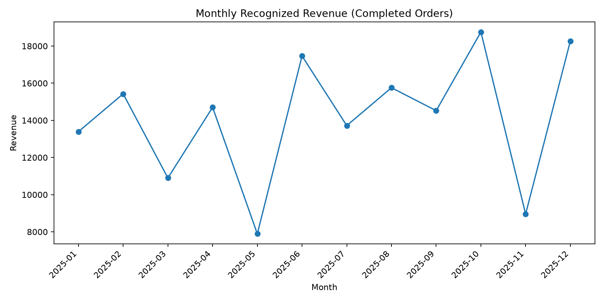

# E-commerce Sales & Customer Insights

A portfolio project showing how to clean, validate, and analyze e-commerce order data with **Python (pandas), SQL, and business-focused reporting**.

> **Important:** The dataset is fully synthetic and was created for this portfolio project. It contains no real customer or company information.

## Business question

How do revenue and estimated profit vary by month, product category, and region—and how can we make sure the reporting is reliable?

## Tools used

- Python and pandas for data validation, aggregation, and analysis
- SQL (Snowflake-compatible syntax) for reporting queries
- Matplotlib for a monthly revenue chart
- CSV outputs that can be imported into Excel, Power BI, or Tableau

## What is included?

- `data/orders.csv` — synthetic order-level data
- `sql/analysis_queries.sql` — monthly reporting, category performance, and validation queries
- `analyze.py` — reproducible analysis script
- `outputs/` — example summary tables and a revenue chart
- `requirements.txt` — Python dependencies

## Business rules

- Only orders with status `Completed` contribute to recognized revenue and estimated profit.
- `Cancelled` and `Returned` orders contribute zero recognized revenue and zero estimated profit in this example.
- `estimated_profit` is a simplified estimate based on synthetic product cost assumptions; it is not an accounting profit measure.
- An order is counted once by `order_id`, and unique customers are counted by `customer_id`.

## How to run it

1. Install Python 3.10 or newer.
2. Download or clone this repository.
3. In a terminal, run:

   ```bash
   pip install -r requirements.txt
   python analyze.py
   ```

4. Open the generated files in the `outputs/` folder.

## Example findings from this sample dataset

- Total rows in the synthetic dataset: **850**
- Completed orders: **755**
- Recognized revenue from completed orders: **$169,758.47**
- Estimated profit from completed orders: **$55,399.54**
- Cancelled or returned share of order rows: **11.2%**
- Highest-revenue category: **Electronics**
- Highest-revenue region: **South**

These findings describe only the generated sample data. They should not be interpreted as results for a real business.

## Data quality checks

The Python script checks for missing order IDs, duplicate order IDs, non-positive quantities, and discounts outside the 0–100% range. The SQL file includes equivalent checks and a duplicate-ID query.

## Suggested next steps

- Load `orders.csv` into Snowflake and run the SQL queries.
- Build a Power BI or Tableau dashboard with monthly revenue, estimated profit, average order value, and order status.
- Add tests for missing dates, unusual revenue values, and unexpected order-status changes.

## Portfolio summary

I built a small end-to-end analytics workflow using synthetic e-commerce data. It combines SQL reporting, Python-based validation, KPI summaries, and a chart to demonstrate how I approach business questions and check data before sharing insights.

## How to run it

1. Install Python 3.10 or newer.
2. Download or clone this repository.
3. Open a terminal in the project folder and run:

   ```bash
   pip install -r requirements.txt
   ```

4. Run the analysis:

   ```bash
   python analyze.py
   ```

5. Open the generated files in the outputs/ folder.

6. <box border radius="lg" padding={3} gap={2}>
  <text preserveWhitespace>{`## Monthly Revenue Trend

`}</text>
<button block variant="outline" onClick={() => GenUI.copy("## Monthly Revenue Trend\n\n
")}><icon name="copy" size="sm" inline/> Copy chart section</button>
</box>

## Monthly Revenue Trend


